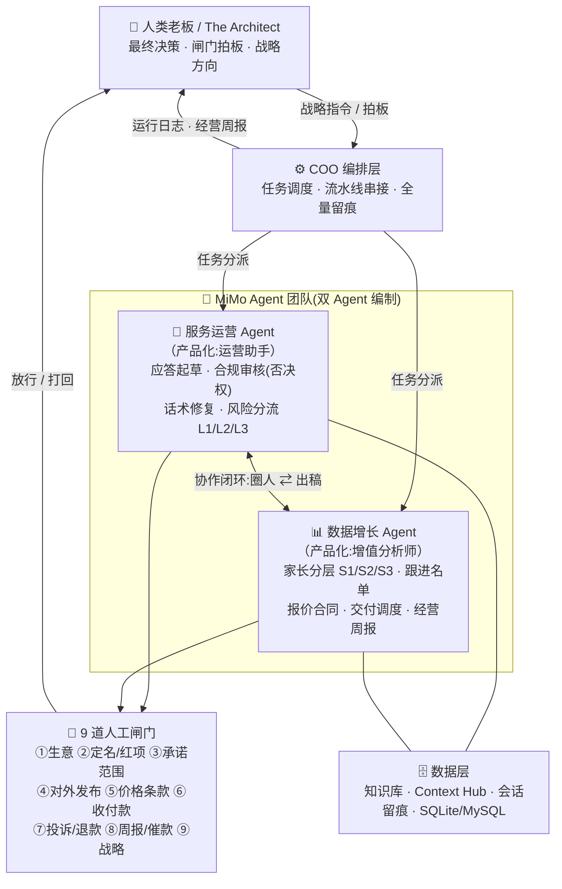
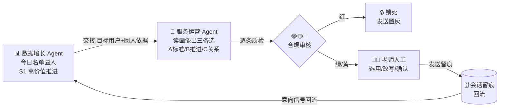

# Agent 组织架构与人机分工

> JUNCTION CHINA 2026 人工智能赛道(Xiaomi MiMo)·「OPC · 一人公司」
> 配套提交材料:**Agent Organizational Structure / Agent 组织架构图**

## 0. 一页总览

一家由 **1 位人类老板 + MiMo Agent 团队**运营的 AI 社群代运营公司。Agent 侧为**双 Agent 编制**(服务运营 Agent、数据增长 Agent),由 **COO 编排层**调度串场;所有不可逆/对外/资金动作经 **9 道人工闸门**由老板拍板;全程动作留痕,违规自动打回重跑。

## 1. Agent 清单与职责

### 🟡 服务运营 Agent(产品化:运营助手)

公司的「服务线」,面向家长的一线运营。

| 职责 | 说明 | 自主程度 |
|---|---|---|
| 应答起草 | 检索知识库(SOP/异议手册),生成三个定位不同的备选话术 | ✅ 自主 |
| 独立合规审核 | 确定性词表 + MiMo 二审,红/黄/绿三态,**拥有一票否决权** | ✅ 自主(否决即终止) |
| 话术修复 | 被否决后按违规清单重写,≤3 轮评审循环 | ✅ 自主 |
| 运营内容生成 | 日度运营包(SOP 三线内容)生成 | ✅ 自主 |
| 风险分流 | L1/L2 自动处置,L3(投诉/退款/法律)升级人工 | ✅ 自主(L3 转人工) |
| 实际发送 | —— | ❌ **永不自动外发**,老师点击触发 |

### 🟢 数据增长 Agent(产品化:增值分析师)

公司的「增长线」,面向客户的经营与决策支持。

| 职责 | 说明 | 自主程度 |
|---|---|---|
| 家长分层 | S1/S2/S3 确定性硬规则(活跃度×意向度),依据可解释 | ✅ 自主 |
| 跟进名单 | 每日批处理 + 阶段停滞触发,出名单 + 专属话术 | ✅ 自主(只出名单不触达) |
| 报价与合同 | 按定价档位出报价单、服务协议要点 | ✅ 自主(条款过闸门⑤) |
| 交付调度 | 模拟收款、交付回执、财务入账 | ✅ 自主(资金过闸门⑥) |
| 经营周报 | 汇总动作日志/工单/运营包成一页纸周报 | ✅ 自主(决策过闸门⑧) |

### ⚙️ COO 编排层(调度,非对话 Agent)

任务串场与留痕中枢:串行流水线(SOP→生成→合规→发布)、评审循环(打回重写)、人机协作(风险升级)、跨系统操盘(日志→周报)。不对外说话,负责「组织持续运转」。

## 2. 协作:双 Agent 如何分工、协作、汇报

### 2.1 协作闭环(核心,日常主循环)

- **分工**:增长线圈人(谁值得跟)、服务线出稿(怎么跟)——判断与执行分离
- **协作**:通过共享画像与会话留痕交接;实测闭环——分析师圈定 S1 用户 → 助手出三备选 → 老师发送留痕 → 意向证据 2 项→3 项回流 → 名单刷新
- **汇报**:每次运行写入动作日志;日度出运营包、周度出经营周报,向老板汇报

### 2.2 汇报关系

| 频率 | 报告 | 内容 | 去向 |
|---|---|---|---|
| 每次运行 | 动作日志(全量留痕) | 任务/输入/输出/耗时/token/闸门结果 | 系统留痕,可回放 |
| 日度 | 运营包 | SOP 三线内容 + 工单 + 升级建议 | 老师/老板 |
| 实时 | L3 升级工单 | 投诉/退款/法律疑难 | 闸门⑦老板拍板 |
| 周度 | 经营周报 | 经营数据、成本、决策项 | 闸门⑧老板决策 |

## 3. 决策权:哪些自主、哪些人工拍板

**设计原则**:Agent 可自主完成一切**可逆、内环、有留痕**的动作;凡是**不可逆、对外、涉及资金、承诺与战略**的动作,一律人工闸门。

### ✅ Agent 自主决策(无需人工)

- 话术三备选生成与改写(可逆,稿子可重出)
- **合规判定与一票否决**(红灯直接锁死——Agent 有权「不放行」,这本身就是自主决策权)
- 家长分层 S1/S2/S3、活跃度/意向度判定(确定性硬规则,依据全披露)
- 风险 L1/L2 定级与自动处置
- 评审循环内的打回重写(≤3 轮)
- 名单、运营包、周报的**生成**(出稿,不执行)

### 👑 人工介入 / 老板最终决策(9 道闸门)

| 闸门 | 事项 | 为什么必须人工 |
|---|---|---|
| ①②③ | 做什么生意、定名、承诺范围 | 公司战略与合规底线 |
| ④ | 对外公开发布 | 黄稿勾「我已确认」才发;实际发送由老师点击 |
| ⑤⑥ | 价格条款、真实收付款 | 资金与合同不可逆 |
| ⑦ | 投诉/退款/舆情/法律 | L3 高风险,Agent 只出处置建议 |
| ⑧⑨ | 周报决策、对外催款、战略 | 经营方向不可委托 |

**边界设计**:即使人工介入,Agent 也只**出稿与建议**——服务端不存在自动外发路径,一切对外消息由老师在 Web 端点击触发并留痕(选用备选/是否改写/质检状态)。

## 4. 组织设计要点(与普通 Agent Demo 的区别)

1. **不是单点 Agent,是有编制的组织**:判断(分层)、执行(出稿)、监督(合规)、调度(COO)、决策(闸门)五种权责分离,互相校验
2. **Agent 有权说「不」**:合规审核一票否决,红灯连人工勾选都不可发送(接口层 409 硬拒)——监督权独立于执行权
3. **持续运转而非一次性问答**:日度运营包 + 40+ 小时经营流水 + 周报,组织按节奏跑
4. **人机边界可审计**:9 道闸门 + 全量留痕(动作日志/工单/会话回放),哪些是 Agent 做的、哪些是人拍板的,全程可核验
5. **真实过程包含失败**:运行日志保留 ERROR、评审 REJECT→修复→PASS 等真实痕迹,证明组织具备自我修正能力,而非预设脚本

---

*本文档为提交材料 ⑤「Agent 组织架构图」的说明正文;图可由 Mermaid 导出 PNG 一并提交。*
