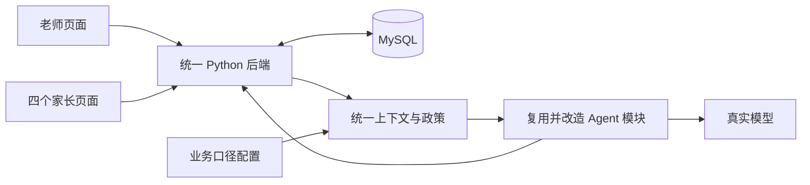

# 女娲补天计划

版本：v1 已获用户批准  
日期：2026-11-08，Asia/Shanghai  
执行状态：核心实施和本机端到端联调已完成；业务方尚需确认部分产品口径，五台实体设备的现场网络仍需验证。实际完成程度和限制见 `女娲补天交付与验收记录.md`。

## 计划要交付什么

交付一个可以持续操作的儿童阅读营 AI 辅助工作台：一个老师、四个家长，用账号密码登录同一网站，完成私聊和固定群聊。消息真实保存、各端同步；老师能使用 AI 的三条建议、收到敏感提醒，并在发送前接受审核。画像与统计能追溯到数据库记录，四个家长的初始故事与时间线提前准备，支撑黑客松演示。

开发按可运行的场景逐步完成。当前页面、旧后端、远程 Agent、MySQL 的重叠部分统一，缺失部分补上。价格、退费等业务待定值集中配置，允许业务在开发期间补齐。

本文是接下来执行时的主计划。需求变化优先记录于 `knowledge/business_policy.json` 和 `项目对齐记录.md`，再同步本计划相关阶段；不继续维护多份互相冲突的执行方案。

## 一 已确认且执行时必须遵守的范围

| 项目 | 本版决定 |
|---|---|
| 场景 | 儿童中文阅读识字、21 天阅读营，清理考研与初高中提分占位例子 |
| 登录 | 1 个老师、4 个家长；支持五设备和同机五个独立页面 |
| 聊天 | 四个老师与家长私聊，加一个固定演示群；新消息真实保存、同步和回看 |
| 发送 | 老师选择、修改或自定义后主动点击发送；AI 不自动发给家长 |
| AI 建议 | A 标准口径、B 推进型、C 关系型；完整当前会话上下文，结合真实画像和人工标签 |
| 质检统计 | 原卡片名称“质检拦截”保留，统计触发质检的家长敏感消息；老师发送被拦不计入该卡 |
| 发送审核 | 老师最终正文仍需审核；敏感入站不封锁所有回复，合规安抚和转私聊可以发送 |
| 高活跃 | 七日内至少 4 天且日均至少 10 分钟，日均按七天总时长除以 7；缺失与零分开 |
| 画像数据 | 使用真实阅读记录和真实对话；没有依据的数值分数、测评次数、价格页停留等占位指标清除 |
| 工作台 | 三张核心卡＋今日跟进；删除 AI 自动回复卡和底部双智能体展示；五阶段大看板暂不作为必做 |
| SOP | 静态可查询文档；不要求状态机、自动催办和复杂修改范围 |
| 演示数据 | 允许补私聊、准备四个家长初始场景、预生成今日跟进、平移历史时间；保留数据来源 |
| 数据结构 | 保留现有 JSON；只补核心功能必需的结构和转换，不全量重建数据库 |

以下作为本计划的推荐实施默认值，用户审阅可以直接修改：固定群先做文字聊天与历史媒体占位；消息同步先用 1–2 秒增量轮询；AI 标签显示证据，老师通过人工标签补充修正；尚未定义的 100 分制评分改为高/中/低及依据；暂不增加独立负责人账号。

## 二 四部分如何放到一起

采用**一个网站入口＋一个 Python 应用后端＋MySQL＋后端内部 Agent 模块**。保留当前白绿前端的视觉基础和免构建路径；不为本次接线迁移到另一套前端框架。

| 现有部分 | 采用什么 | 需要调整什么 |
|---|---|---|
| 当前 `web/index.html` | 布局、配色、老师工作台和候选卡基础 | 用接口数据替换静态对象，补登录和家长端，修初始化/消息左右/候选可读性，清理假成功按钮 |
| 当前 `web_api` | Python 服务入口、静态文件托管和任务处理经验 | 加统一新业务接口、登录鉴权和消息服务；旧工单 API 不驱动新页面 |
| 当前 `opc` | 可用模型适配、知识读取、规则和日志经验 | 支持完整历史输入、集中政策注入；清理与本版冲突的硬编码与旧审批路径 |
| 远程 `dual-agent` | 候选生成、画像、质检及 Repository 的业务基础 | 合入有用模块，替换 SQLite 实现；改阈值、上下文、渠道与登录身份；仅保留一个实际服务入口 |
| MySQL | 原有用户、外部身份、会话、成员、消息和原始画像 | 原始导入数据保留；新增演示会话及应用记录；后端统一做数据转换 |

旧 SQLite 工单数据保留作为历史实验，新聊天、画像和统计以 MySQL 的同一份消息记录为依据。数据库 MCP 继续用于开发查库，网站运行时直接通过后端访问数据库。

实现时建议将账号、会话消息、画像、审核等职责分成小模块。可在合入后的 `service/` 中组织业务，在 `web_api` 留唯一 HTTP 入口；具体模块文件名由实现者按合并结果确定，职责与数据契约固定。

## 三 分阶段施工顺序

依赖顺序：**阶段 0 基础验证 → 阶段 1 数据与契约 → 阶段 2 真实聊天 → 阶段 3 AI 与质检 → 阶段 4 画像与统计 → 阶段 5 页面与演示收尾 → 阶段 6 全链路验收。**

阶段 0、1 建立政策读取与画像基础，使阶段 3 已能使用真实阅读上下文。阶段 4 再完成完整画像展示、分层、工作台聚合。业务口径在这些阶段中途到达，可集中接入。

### 阶段 0 固定现场并验证基础能力

**目的：先确认关键外部条件，保护已有工作。**

工作内容：

1. 在合适的当前 checkout 上创建 `codex/nuwa-mvp` 工作分支；保留用户已有前端改动和本轮文档，记录基准与本地快照。密钥、数据库配置、证书和运行数据继续排除于版本提交。
2. 只读检查远程 `dual-agent` 最新版本，与此前核查提交 `83abffae48b934aa1d99609983bbe255666717bd` 对比；按模块选择性合入，处理同名 `opc` 变更，避免整分支覆盖当前页面和已确认规则。
3. 读取数据库约束和权限。在计划批准后，仅对新建专用演示/应用对象验证创建、插入、查询、事务与清理能力；不修改原始导入群消息。迁移若受权限限制，产出精确 SQL 和错误，继续不依赖写入权限的实现，标明聊天验收仍受阻。
4. 检查实际可用的模型端点、凭据读取方式和可部署性。沿用可用适配器，做少量真实请求，验证三候选结构与审核输出。密钥不返回给浏览器。
5. 选一个候选演示群，统计其完整文本历史输入规模，实际验证所选模型容量和耗时。历史媒体先保留类型/占位，不声称已经读取图片语音内容。
6. 运行现有相关基线检查并记录原有失败；定位 `#active-avatar` 等页面初始化问题，纳入后续修复。计划阶段发现的静态问题不当作已复现通过。

产出：确定的合并基线、可用数据库写入路径、模型能力结果、推荐主演示群、已知失败清单。

验收：知道应用数据将写到哪里，知道真实模型如何调用，并有完整上下文容量的验证结果。若外部权限/模型容量不足，明确对应受阻项并继续其他独立工作；不以纯 mock 结果冒充这一阶段通过。

容量不足时先尝试已可用的大上下文模型；仍不可满足时，把“完整历史”与可用容量的具体矛盾提交用户决策，同时继续聊天主链。不得静默截成最后 N 条，也不得自行将完整历史要求降级。

### 阶段 1 补数据底座和统一契约

**目的：让所有功能使用同一个用户、同一个会话和同一套数据解释。**

工作内容：

1. 区分登录账号 ID、MySQL user_id、外部 App ID、conversation_id、message_id；所有 JSON 接口的数据库大整数 ID 用字符串传递，避免浏览器精度损失。
2. 完成 MySQL Repository，统一用户、会话、成员、消息读取与写入。对新增结构使用可重复执行、非破坏性的迁移；已有消息索引直接使用。数据库连接按请求/后台任务管理，不把队友 SQLite 单例连接的线程用法直接搬到 MySQL；消息保存、成员检查和发送留痕有明确事务边界。
3. 建立画像转换：中文营期日序、`12分16秒` 转秒、明确的零/缺失、报名/测字/会员链接/家长课字段；保留原始 JSON。提供阶段 3 可用的基础阅读事实。
4. 接入 `knowledge/business_policy.json` 的读取、状态校验和版本。将 confirmed 与运行默认建议区分，pending 保留未知；生成、审核、模板和规则页面使用同一来源。具体价格和政策空缺不阻塞。
5. 从同一个群挑选四个可关联真实画像的家长，覆盖高阅读、互动较多、低阅读等差异。此前 D4342 中 user_id 201、198、194、176 仅为候选，最终以当前记录与成员关系核实为准；不能声称他们具有未识别出的高购买意向。
6. 选择/绑定一个老师身份，准备四个账号及四个私聊、一固定演示群。演示账号展示名可以统一风格，真实来源关系保留。
7. 实现幂等初始化：重复运行不重复造用户、消息与会话；尊重现有 direct_conversation_pairs 的唯一约束，复用已经存在的私聊，不为每次启动重建同一对用户的私聊。
8. 建立固定演示时间偏移：首场初始化固定，历史最后一条落在场次开始前，现场消息接续真实时间；记录 original_time/effective_time，所有展示和统计用一致的有效时间。

历史群的处理：采用来源映射，新演示群读取选定历史群的完整消息，并与该演示群的新消息合并展示；历史来源不可写。历史消息使用包含来源的稳定复合 ID，与新消息 ID 区分，分页、候选引用、敏感识别和统计使用同一映射。老师与家长的访问先校验演示会话成员，来源映射不开放为任意读取其他会话的入口。不使用不说明的随机截样，也不复制全库。

阅读日期未完全确认时，固定使用营期末七天做阅读指标，明确标注；互动仍按平移后的日历时间。暂不伪造二者为同一七日窗口。历史正文里的旧价格、旧活动和日期不成为当前政策事实。

产出：数据迁移、Repository、账号映射、演示初始化、基础阅读指标、政策读取器、约定好的接口数据结构。

验收：同一账号能准确关联到家长画像和会话；转换后数字可与原记录核对；初始化再次运行不重复；重启不重新漂移历史时间；原始导入消息未改变。

### 阶段 2 先补成真正可用的聊天

**目的：完成一套不依赖模型成功的通信底座。**

工作内容：

1. 新增登录页：账号密码校验、密码哈希、服务器会话、老师/家长角色；页面独立保存登录令牌，支持同机不同标签页使用不同账号。
2. 老师页接会话列表、搜索、历史消息和私聊/群聊切换。新家长页只提供老师私聊与固定群聊、输入发送、历史回看和未读提示。
3. 家长、老师每条新消息都经后端保存；发送者由登录身份决定。按成员权限控制读写，家长不能读其他家长私聊和老师内部信息。
4. 先用增量轮询完成五端同步、断线恢复和已读更新；消息稳定排序、双击/重试去重。显示发送中、成功、失败；数据库提交后才显示成功。
5. 修正两端消息左右和角色称呼。发言归属以当前登录用户判断，老师主动发送显示老师身份。
6. 群聊提供“选中此消息回复”的能力，独立维护群 ID 和目标家长/目标消息 ID，为阶段 3 做准备。
7. 对家长/模型/数据库消息安全地按文本渲染，替换把原文直接拼进 `innerHTML` 的路径。

阶段中间的手动聊天可以内部联调；待阶段 3 接完发送审核后，才视为可交付给用户的老师发送入口。

产出：登录、老师与家长页面、四私聊和群聊、真实收发、持久化及同步。

验收：两个以上独立页面能互相收发，五账号同时使用不串身份；刷新及服务重启后消息仍在；同一消息重试只保存一次；私聊隔离、群成员可见范围正确。

### 阶段 3 补上真实 AI 与两条质检链

**目的：使“AI 辅助、老师发送”成为可验证的真实功能。**

工作内容：

1. 家长消息先提交数据库，再登记生成任务和入站识别任务；从服务端读取当前会话完整有序历史、目标家长画像、人工标签、有效政策和参考话术。
2. 修改模型调用输入以容纳完整带角色历史。群聊上下文标明每个发送者，私聊不注入其他家长私聊；未识别媒体只标类型，不推断内容。
3. 接队友三候选逻辑，校验 A/B/C 的完整性、策略差异与输出结构；默认候选真实由模型生成。失败显示原因，可重试，备用模板明确标识且同样读取当前政策。
4. 每组候选绑定 conversation_id、target_message_id、context_revision 和 policy_version。迟到任务不覆盖另一会话；新消息到达或政策变化时标记候选过期，保留老师正在编辑的草稿并允许重新生成。
5. 入站敏感识别：每条家长消息输出敏感与否、主题、原文证据、理由、识别状态；结合规则与模型语义。多主题/重跑/三候选不重复增加计数，失败为待识别。
6. 出站审核：候选逐条标风险；老师选择、编辑或完全自定义后，发送接口重新审核最终正文。包括确定性硬规则与独立语义审核，返回绿/黄/红、原因和改写建议。
7. 红色不发送；黄色确认绑定当前文本，修改后需重新确认/检查；合规安抚和转私聊不因家长问了退款而被整体封锁。审核不可用时标待审核，不伪装绿色。
8. 候选选择、编辑差异、审核状态、发送人和时间留痕；家长接口只返回已发送消息，不含候选、画像与内部质检。

业务未定期间：按已确认核心原则和集中清单的临时实现建议联调，未确认商业事实使用核实型回复；敏感主题/红黄边缘规则标记当前采用的默认版本。业务确认后替换配置，补相关案例验证。

产出：真实三候选、完整上下文组装、异步状态、入站敏感识别、出站审核、发送留痕和清晰的候选输入区。

验收：一次真实家长提问可产生三条不同策略建议，老师修改后能经审核发出；违规承诺被后端阻止；同一敏感家长消息只计一次；生成失败不丢消息；群里切换回复目标后画像和候选均跟随正确家长。

### 阶段 4 补画像、工作台和跟进

**目的：展示内容能由真实记录解释，并与聊天联动。**

工作内容：

1. 阅读指标使用真实逐日数据与已确认的 4/10 规则。显示高/中/低、天数、总量/日均、窗口和数据截至时间，缺失数据单独说明。
2. 语义提取近三日家长意向信号，保存消息依据；按不同信号类型去重计算等级。默认按 Word 的两类为高、一类为中，业务用语由配置维护；老师的推销不算家长意向，拒绝不当推进。
3. 行为概括真实调用模型，基于计算后的阅读事实和家长对话生成；带来源版本与更新时间。老师手动标签支持增删、署名和时间，后续候选可用。
4. 对话右侧与独立画像页读取同一服务结果，切家长不串数据。移除没有算法定义的 92/88 分和不存在的数据指标。
5. 工作台三卡与名单接真实查询：今日会话按家长去重；质检卡按家长入站敏感消息聚合；高意向按信号结果统计。今日/昨日均采用统一场次时间与范围。
6. 今日跟进选真实用户 ID、画像和最近消息预生成摘要/建议，可点击直达会话；允许准备好的缓存，不宣称每日定时任务已经存在。
7. 初始化后按同一算法预处理演示历史与私聊种子，准备有依据的初始统计。可以调整演示故事覆盖目标场景，不手填虚假计数，不篡改阅读行为。

统计范围默认绑定当前老师负责的主演示群与四位演示家长，避免将全库无关群数据混入四人展示；若提供“所有历史客户”浏览，应明确为另一范围。工作台的名单双向回溯到消息和用户，计数与名单一致。

产出：真实画像、可解释意向、人工标签、三卡与名单、预生成跟进。

验收：随机抽一个家长可从逐日记录复算阅读结论；敏感卡可点到对应消息；同家长群聊与私聊去重符合定义；现场新消息会更新识别与统计，不只初始化时有数据。

### 阶段 5 补演示完整性与页面收尾

**目的：让真实能力清晰呈现，减少现场操作成本。**

工作内容：

1. 四位家长分别准备普通咨询、会员价格/权益意向、阅读顾虑、退费/投诉中的初始场景，均绑定真实画像；模拟私聊保留 seed/source 标识，实际操作产生的新消息真实入库。
2. 预先生成可追溯的历史敏感识别、意向和今日跟进。准备一条正常回复和一条敏感问答的顺畅演示路径；出站拦截另作为补充验证，不要求不断编违规话术来撑统计。
3. 保持现有白绿风格，增大候选文字和点击区域，清楚区分策略、风险、待生成、失败、已过期；输入框可以自由修改。
4. 删除 AI 自动回复卡和双智能体展示；五场景区优先让位于今日跟进。替换考研/提分文案、静态日期、虚构成绩和固定统计。
5. SOP 改静态阅读营参考文档；话术/质检页从同一政策读取。导入、上传、复杂 SOP 修改等未实现动作收起，不保留只弹“成功”的按钮。
6. 新家长页面作为实际演示入口；现有模拟手机窗可降为家长端入口/预览，避免维护第三套独立消息状态。
7. 业务决策若已到达，更新统一配置、停用冲突旧知识、重审相关候选并重算受影响统计。尚未给出的产品值继续显示待核实，不整批阻塞展示。

演示数据操作边界：本版提供幂等初始化与继续当前场次，不把“刷新/重置页面”做成删除业务消息。需要清理时仅清理明确标识的专用演示记录，保留原始导入数据、真实账号绑定与审计边界；不自动清空数据库。

产出：可重复进入的演示内容、可读的老师/家长界面、真实的状态反馈、简化后的 SOP 与话术页。

验收：四个家长都有内容和真实画像；工作台、对话、画像、家长端指向同一记录；未开发功能不假装执行成功。

### 阶段 6 验收、启动和交接

**目的：把完成度落到实际运行结果。**

工作内容：

1. 对新增核心逻辑做必要自动验证：权限与身份、持久化、重试去重、阅读转换与边界、入站计数、最终正文审核、候选串台与政策变化。复用适用的旧测试，改掉只适用于旧工单的假设。
2. 在浏览器完成真实流程验证：五个独立账号/页面，私聊与群聊，真实模型，刷新/重启，敏感统计、红黄绿和人工改写。测试结果区分真模型、模板与测试替身。
3. 明确并配置一个可共同访问的启动地址。保留同机运行路径；五设备使用同一后端，验证模型端点和数据库在该环境都可访问。新服务使用适合演示的部署方式和最小必要配置，不复用旧分支更新脚本强行启动。
4. 更新启动说明和最少依赖，提供简单启动入口与健康检查。数据库密钥、模型密钥在服务端；登录密码放单独的本地演示账号说明，不进公共提交。
5. 输出完成清单、实际测试结果、仍待业务确认项、已知限制与恢复方式。不得以“单元测试全绿”替代端到端真实运行。

产出：可启动代码、必要迁移与初始化、五账号使用说明、演示步骤、验收记录和已知限制。

用户批准本计划后，本地实现、专用演示数据准备和联调按计划推进。涉及外部发布或部署时，先完成本地可审阅结果；最终访问环境缺失时集中说明具体所需信息，避免开发中途反复询问同一问题。

## 四 最小数据补丁

不将 `users.profile` 全量拆表。现有 `users`、`user_identities`、`conversations`、`conversation_members`、`messages`、`direct_conversation_pairs` 尽量复用，新增应用结构使用 `opsie_` 前缀区分。下面是职责清单，具体字段和可合并表由阶段 1 根据现有约束确定。

| 新记录 | 最少需要表达什么 | 用途 |
|---|---|---|
| 登录账号与会话 | 账号、密码哈希、角色、user_id、令牌摘要、到期时间 | 五账号与独立页面登录 |
| 演示场次与来源映射 | 固定时间偏移、原群 ID、新演示群 ID、初始化版本 | 历史与现场接续，避免重复造数据 |
| AI 任务与候选 | 会话、目标消息、上下文版本、政策版本、状态、A/B/C 正文 | 异步生成、迟到结果隔离、可追溯选择 |
| 入站识别 | 家长 message_id、敏感结论、主题、证据、状态、政策版本 | 敏感提醒与卡片计数，按消息去重 |
| 出站审核与发送来源 | 正文摘要、审核结果、原因、确认、候选选择和编辑状态、最终 message_id | 最终正文审核与老师发送留痕 |
| 人工标签和画像缓存 | 用户、标签、添加者/时间、摘要来源版本和截至时间 | 个性化和跨页一致 |

扩展信息仍可用 JSON。必要关系、检索键、状态和时间使用明确列；这次不追求把所有扩展属性规范化。必要索引围绕成员会话、消息分页、识别去重和任务状态设置。

密码验证/身份检查用确定性代码；阅读分级/统计用确定性计算；模型负责语义识别、摘要、候选及独立语义审核。各自职责不能混用。

## 五 统一接口与数据契约

下面按职责规定最少接口。执行时可以沿用队友的 `/api/v1` 路径并保持兼容，但同一职责只有一个权威入口；新生成接口不再承担重复插入家长消息的副作用。

| 接口职责 | 请求关键字段 | 返回/行为 |
|---|---|---|
| 登录、当前身份、退出 | 账号密码/当前令牌 | 当前用户角色与会话；不接受浏览器伪造 sender |
| 会话列表 | 当前身份、搜索 | 所属会话、类型、最后消息、未读 |
| 历史与增量消息 | conversation_id、分页/增量游标 | 稳定 ID、sender、类型、正文、有效时间、来源；只返回有权限内容 |
| 保存家长/老师消息 | conversation_id、client_message_id、正文、可选引用 | 数据库提交结果；家长消息触发后台任务，老师消息先过出站审核 |
| 生成/重新生成候选 | conversation_id、target_message_id | job_id、版本与状态；不重复保存入站消息 |
| 任务与候选状态 | job_id/当前目标 | A/B/C、生成来源、逐条质检、错误和过期状态 |
| 最终正文审核 | 最终正文、渠道、当前目标 | 三态、原因、改写建议、正文绑定的确认要求；实际发送时再次校验 |
| 画像与人工标签 | user_id/标签操作 | 真实指标、窗口、来源、摘要、标签和意向依据 |
| 工作台与名单 | 当前老师、演示范围、日期 | 三卡数字、对应用户/消息名单、跟进摘要 |
| 静态知识与有效政策 | 当前用户角色 | 可展示的 SOP、话术与规则；不下发密钥和私有内部上下文 |

后台模型任务至少有 queued/running/succeeded/failed/interrupted 状态；服务重启后未完成任务可标为中断并重试，不留永远转圈。轮询用于当前五人演示，无需先引入 Redis、独立消息队列或微服务。

## 六 业务决策晚到时的处理

| 待决策内容 | 开发期间采用什么 | 业务给结果后接哪里 |
|---|---|---|
| 价格、权益、退款、到期权限 | 字段留空，生成核实型回答；旧素材不能当现价 | 统一政策 → 候选上下文、模板、话术页与审核事实核对 |
| 哪些家长问题算敏感 | 集中记录已知场景和建议主题；对边界样例标待确认 | 入站敏感识别政策 → 重算受影响识别和工作台统计 |
| 锁价/师资等红黄等级 | 明确当前默认建议，未知事实不作承诺 | 出站规则 → 候选标注和最终发送审核 |
| 营期日期 | 阅读显示营期末七天，聊天显示近期互动 | 数据转换和时间映射 → 统一窗口后重算活跃 |
| 意向用语与分层边缘条件 | 按 Word 建议定义并附消息依据，避免装饰分数 | 意向规则 → 画像、工作台和跟进 |

每项完整冲突、待填值与接入位置继续维护在 `knowledge/business_policy.json`，阅读版见 `业务口径冲突清单.md`。一般业务值变化不重写接口和页面；新规则类型/新流程按必要范围开发。

## 七 真实能力与准备内容的分界

| 必须真实执行 | 可以提前准备 |
|---|---|
| 登录身份与权限 | 五个演示账号的初始配置 |
| 现场收发、保存、同步、回看 | 缺失的私聊初始故事与固定演示群 |
| 真实数据库读取与阅读计算 | 历史时间偏移和来源映射 |
| 现场 AI 三候选与语义判断 | 历史消息的预处理缓存 |
| 最终正文发送前审核 | 今日跟进的预生成摘要 |
| 根据记录聚合敏感次数和名单 | 静态 SOP 和经过确认的基础话术 |

所有现场新增行为必须真实更新记录。准备内容保留来源和计算依据，不能用固定卡片数字取代聚合查询。

## 八 可压缩项与必须保住的顺序

第一优先保住：数据映射与写入、五账号聊天、真实 AI、入站敏感统计、最终正文审核、真实阅读画像。

时间不足时，按下列顺序缩减：

1. 去掉复杂图表、阶段看板与装饰性分数。
2. 今日跟进采用预生成，SOP 和规则采用只读展示，收起上传/编辑入口。
3. 家长端仅保留会话列表、聊天和退出；群仅保留文字、成员名和消息回复目标。
4. 历史附件显示类型占位，音视频播放和上传延期。
5. 省略没有可靠历史依据的同比百分比，保留真实数字、名单和来源时间。

这些简化不得变成：只在前端数组保存、固定回复冒充真实模型、取消发送审核、写死敏感次数、遗漏一对一或群聊、用另一人的画像、悄悄截断上下文。

本版暂不做任意拉群/踢人、完整企微对接、模型训练、每日自动触达、退款执行、复杂负责人审批、全量 JSON 拆表。

## 九 审阅通过后的最终验收场景

| 编号 | 操作 | 应看到的结果 |
|---|---|---|
| A | 五个账号同时登录，包含同机多页 | 互不顶号；老师和家长页面职责正确 |
| B | 家长 A 私聊老师，老师手动回复 | 双端显示同一消息；刷新、重启仍在；家长 B 看不到 |
| C | A 和 B 在群里发问，老师切换目标 | 群成员都看到已发消息；右侧画像与三候选跟随选中家长 |
| D | 家长发“能退款吗” | 真实消息保存；出现敏感提醒；质检卡按该消息增加一次；合规回复可以发送 |
| E | 对 D 连续重新生成/刷新/重试 | 三候选可更新，但同一敏感消息的计数不叠加 |
| F | 老师输入违规承诺并尝试发送 | 后端阻止，家长看不到；家长敏感消息计数不额外增加 |
| G | 老师选择候选后修改正文 | 以修改后的最终文本审核；旧确认不覆盖新文本 |
| H | 查看高阅读与低阅读两个家长 | 指标可由数据库记录复算；七天、日均和依据显示正确 |
| I | 在 AI 生成期间切会话或收到新消息 | 候选不串台；过期状态明确，不覆盖老师正在编辑的内容 |
| J | 模型不可用或审核任务失败 | 消息仍保存；页面显示真实失败/待审核，恢复后可重试 |
| K | 修改一项已确认有效的业务配置 | 新候选与规则页使用同一新版本；旧待发候选重新审核；历史留痕保留 |
| L | 目标演示网络上分别打开老师和家长端 | 同一个网址可访问，真实模型、数据库和同步同时工作 |

案例 D 的措辞是已经明确的敏感主题示例；商业退费答案在业务未确认时采用核实型回复，不虚构可退/不可退政策。F 的具体违规范例由已确认出站原则与规则给出，边界案例随业务定稿补测。

## 十 交付与审阅要点

执行完成后交付：可运行代码、最小迁移和幂等初始化、统一业务配置读取、启动说明、五账号说明、演示操作步骤、实际验收结果、未确认业务项和已知限制。只在代码和验证完成后说明“已经跑通”。

本次审阅主要确认以下五项：

1. 保留当前白绿界面，收敛为一个 Python 后端，内部复用队友 Agent，MySQL 作为新业务统一数据源。
2. 先验证关键外部能力，再按“数据底座 → 真聊天 → AI/质检 → 画像统计 → 演示收尾”推进。
3. 固定四私聊和一个群先完成，复杂微信能力及 SOP 状态机延期。
4. 私聊背景、跟进摘要和历史预处理允许准备，现场消息、AI、审核、数据读取和统计真实执行。
5. 业务未知值集中等待填入，不阻塞独立开发；完整历史容量等实质矛盾及时提出，不静默降级。

用户批准后按此顺序连续推进；阶段内常规技术选择由实现者处理。仅在缺少实际凭据/权限、用户硬要求无法满足、发生不可兼容的业务变更或最终外部发布需要明确决定时集中反馈，不把每一步完成都变成新的审批。
