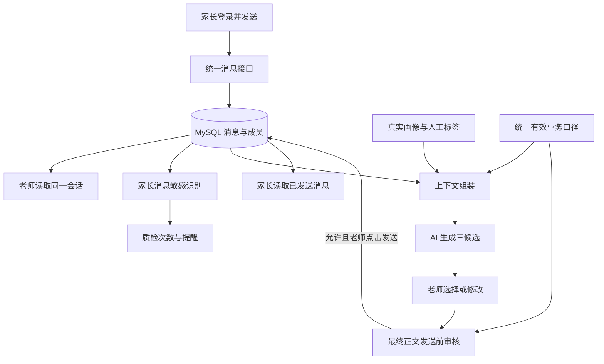

# 端到端功能对照与推进边界

更新日期：2026-11-08。依据本聊天已确认范围、产品 Word、当前工作区代码、此前核查的远程 Agent 分支与 MySQL 数据。本文是整体差距评估和实施前的边界建议，不代表以下功能已经实现或所有建议已经冻结。

本文记录实施前的基线；用户已批准 `女娲补天计划.md` 并开始开发，以下“尚未实现”等描述是当时的核查结论。最新运行结果以交付说明和测试为准。

## 结论和等待范围

业务口径可以边决策边开发。账号、聊天、消息保存与同步、数据库数据转换、模型接入、候选展示、审核记录和指标查询骨架不依赖具体价格、退费政策。高活跃 4 天/10 分钟、质检卡按家长敏感消息计数已确认，可以实施。

需要等业务的是最终对外事实和边界案例验收：多少钱、哪些权益、何时能退、哪些师资/优惠表述判红还是黄、哪些一般问题算敏感。未知事实留空，先生成澄清/核实型回复；技术链路可以完成，但不能声称最终商业政策与完整质检准确性已经验收。

`knowledge/business_policy.json` 是口径维护入口，目前没有运行时代码读取。后续需要先实现读取与校验，才具备“改一个文件即可生效”的能力。一般改值不应要求改代码；新增规则类型、全新流程或新数据库字段仍可能需要开发，不能承诺任何变化都是配置问题。

## 四部分现状

| 部分 | 已存在 | 与目标之间的缺口 |
|---|---|---|
| 当前前端 `web/index.html` | 六页布局、三个样例用户、本地消息数组、三候选展示、模拟手机窗 | 尚无业务请求接线；真实登录、群聊与跨设备同步未实现；多个按钮只弹成功文案 |
| 当前 `web_api` + `opc` | Python 静态托管、任务执行、工单、审批、知识检索与模型调用封装 | 是旧工单/本地 SQLite 流程；与当前页面的数据对象、MySQL 用户和多人聊天不一致 |
| 远程 `dual-agent` | 三候选接口、SQLite Repository、关键词质检、画像计算和留痕 | 未接 MySQL；无登录/群成员权限；没有完整上下文；部分指标口径与新决定不同 |
| MySQL | 用户、外部身份、群、成员、群消息、附件、导入原文和阅读画像 | 无私聊记录、登录会话、候选与独立审核记录；画像需转换；读连接已验证，应用写入未联调 |

远程核查基准为 `83abffae48b934aa1d99609983bbe255666717bd`；接入前重新检查队友更新，不能以旧快照覆盖他的新工作。

## 从页面到数据的功能对照

“可先做”指不必等待业务口径最终决定，不是已经完成。“补齐”包含新接口或改适配层，并不必然要求重构框架。

| 功能 | 页面/文档现状 | 后端与数据库需补齐 | Agent 的职责 | 第一版边界与等待项 |
|---|---|---|---|---|
| 账号登录 | Word 要求 1 老师 4 家长；页面无登录 | 演示账号、密码哈希、会话令牌、账号到 MySQL user_id 的绑定、角色检查 | 不参与身份校验 | 可先做；同机多页登录身份独立，服务端仍校验权限 |
| 会话列表 | 目前三个样例联系人，搜索框/新建按钮无完整业务 | 按当前账号取成员会话、最新消息、未读位置；区分 direct/group | 不决定谁能看谁 | 可先做；固定 4 个私聊和 1 个演示群即可，不做任意建群/邀请系统 |
| 历史消息 | 页面本地 conversation 数组 | 查询已有 messages，按时间和稳定 ID 排序、分页；校验成员身份；保留原始来源 | 当前会话有序文本作为上下文 | 可先做；页面分页不等于模型截断历史；媒体先显示占位与类型 |
| 家长发消息 | 当前只有老师端“模拟用户提问”按钮 | 独立发送接口，先保存再返回；发送者取登录身份；幂等消息 ID | 保存成功后触发入站识别和回复生成 | 可先做；模型失败不能吞消息，重新生成不能重插消息 |
| 老师发消息 | 数组 push，发送方标为 ai | 审核最终正文、确认黄灯、保存并通知家长；重复点击只保存一次 | 独立语义审核，可给改写建议 | 可先做机制；完整红黄边界待业务，已确认违规承诺/群内隐私先覆盖 |
| 实时同步 | 手机窗读取同一个前端对象 | 新消息增量查询/通知，掉线恢复、已读更新、同一持久数据源 | 无 | 可先做；五人演示建议 1–2 秒增量轮询先跑通，后续可替换推送 |
| 群聊回复对象 | 当前对象是单个用户，不能表达群和目标家长 | conversation_id 与 target_message_id/target_user_id 分离；群成员与上下文范围 | 基于选中家长消息、该家长画像和群内历史生成 | 可先做；默认最新待回复家长，可点击其他消息切换；不把整个群塞进一个人的画像 |
| AI 三候选 | 三条固定文案；“正在生成”只是提示 | 候选 ID、生成任务、来源消息/历史版本、状态与失败原因、选择/编辑留痕 | A 标准/B 推进/C 关系，读取有效政策、画像和完整当前会话 | 可先做；无价格时仍可给核实型回复，不静默把模板冒充模型 |
| 候选卡及输入区 | 字体偏小、风险绑在用户上 | 每条候选自己的审核结果；选择填入可编辑输入框；切会话清理旧选择 | 可返回风险原因与改写建议 | 可先做；先保证清晰、可选、可改，再做视觉打磨 |
| 入站敏感提醒 | 当前 risk 布尔值，特定样例触发 | 按家长 message_id 保存识别结论、主题、证据、状态和政策版本 | 判定家长消息是否需要慎重处理 | 可先做机制和已知案例；主题全表未定，不能把所有检查次数算入 |
| 质检拦截卡 | 当前固定数字；Word 与用户最新定义不同 | 聚合当日有效时间内的去重家长敏感消息，附名单/消息入口 | 历史预处理和新消息使用同一识别契约 | 按用户最新决定实施；出站拦截不增加此数字 |
| 今日会话卡 | 当前固定 28 和昨日百分比 | 统一日期、账号范围、群/私聊家长去重；支持名单 | 无 | 可先做查询；只有老师单方面私聊的计入方式仍待定，按配置保留 |
| 高意向卡 | 当前固定 5；Word 一处误写高活跃 | 近期家长消息、意图证据、按类型去重的确定性等级、人数和名单 | 提取语义信号，正确识别否定和拒绝 | 可先做数据与分类框架；默认按 Word 三日两类建议，最终业务用语待确认 |
| 阅读画像 | 当前写死打开次数/试听进度/分数 | profile.daily_reading 中文日序解析、分秒转换、缺失标记、分组/时间窗口；4/10 阈值 | 使用算好的数字，不自行计算编造 | 可先做；时间未对齐显示营期末七天，不冒充真实当周 |
| 行为概括 | 当前固定 summary，刷新只是重绘 | 提供真实阅读指标、家长近期对话、数据截至时间；保存摘要来源版本 | 基于上述事实生成简短概括 | 可先做；模型失败保留旧摘要并标旧，不显示刷新成功 |
| 标签与分层 | 页面存在固定 AI 标签和人工备注 | 人工标签 CRUD 与署名时间、AI 证据、未定义数值评分移除 | 生成建议标签；计算规则负责等级 | 可先做结构；AI 标签编辑/分层边缘条件仍按集中口径待定 |
| 今日跟进 | 固定名单及建议 | 绑定真实 user_id，点击跳会话，摘要附来源和更新时间 | 可预生成摘要和推荐理由 | 可先做；用户允许预计算，不要求每日自动批处理 |
| SOP | 页面有修改弹窗；Word 有复杂时限 | 静态内容查阅，业务不依赖 SOP 状态迁移 | 仅参考其中已确认内容 | 已授权简化；隐藏未实现修改/导入按钮，不留假保存 |
| 话术和规则页面 | 固定标准口径、上传和编辑图标 | 从统一政策与有效话术读取；缺项显示待确认 | 与生成、审核共享同一规则版本 | 可先做读取展示；上传解析/可视化规则编辑不纳入必要闭环 |
| 家长端 | 现有手机窗为同页投影，无独立身份 | 独立可登录页面，私聊+群聊，共用消息服务；不返回内部草稿/画像/质检 | 不直接向家长发送草稿 | 可先做；老师点击发送前，家长页面不出现建议内容 |
| 历史与演示场次 | 页面日期、时间和情境写死 | 固定时间偏移、演示私聊种子、来源映射、幂等初始化；重置范围明确 | 使用演示时间判断近期，旧政策不视为现价 | 可先做机制；营期日期需核对，重置不得删除原始群聊 |
| 部署与启动 | 当前服务只监听本机；旧启动脚本仍指 React/旧分支 | 一个共同访问地址、可用模型连接、数据库写入与迁移、正确启动说明 | 在部署环境验证真实调用 | 不依赖业务；当前尚未联调写入、模型或五端体验 |

## 推荐的统一主链

第一版建议保留当前页面作为视觉基础，采用一个浏览器统一访问的 Python 后端，后端统一读写 MySQL，并通过适配层复用队友的 Agent 逻辑。无需为了“两个 Agent”先部署两个相互独立的服务。

旧 SQLite 工单可以保留为历史实验，但不应再成为新聊天的另一份权威数据。聊天显示、AI 上下文、工作台统计和画像应基于同一消息源。数据库 MCP 是开发时查库的工具，不是网站用户发消息时调用的后端。

入站识别和候选生成都应在家长消息保存后触发；它们可以失败重试而不影响消息本身。出站审核失败不产生家长可见消息。接口返回的“发送成功”必须代表数据库已提交，不能只是前端添加了一个气泡。

## 需要固定的技术约定

这些是建议由实现者直接落实的常规选择，无需让业务逐项决策；其中会改变产品范围的部分仍以用户最新指示为准。

1. **身份分清。** 登录账号 ID、MySQL user_id、外部 App ID、会话 ID 分别维护映射；前端小林等字符串不继续当真实主键。服务端从登录会话确定 sender，不信任浏览器自报老师身份。
2. **同机多账号。** 按用户要求使用页面独立保存的会话令牌；新增登录不覆盖其他页面，退出也只清理当前页面。不同设备走同一后端。
3. **固定演示群。** 先做四家长加老师的固定群和四个私聊；搜索、未读、历史回看可保留。任意拉群、踢人、通讯录、语音上传等不先展开。真实历史群来源和可写演示会话分清。
4. **明确群内目标。** 老师点击某个家长消息即可切换回复目标及右侧画像；自己的消息在右，其他人在左；显示真实发送角色，老师发送不再标“服务运营智能体”。
5. **候选不串台。** 每个任务带 conversation_id、target_message_id、context_revision。切换会话后，迟到结果不覆盖当前会话；新家长消息到来时标记旧候选，提示重新生成，不静默覆盖老师正在编辑的正文。
6. **有序且去重。** 客户端发送生成稳定请求 ID，重试使用同一个；入库唯一约束避免双击重复。消息展示用稳定排序，刷新和断线能从数据库继续。服务器消息 ID 与发送者一起作为去重依据，不能只用文本去重。
7. **完整上下文与分页分开。** UI 可分页，模型仍从服务端取当前会话完整可用历史；不能由浏览器只上传可见的最近一屏。群消息必须带说话人，私聊不注入其他家长的私聊。系统提示、政策、标签、时间与原文分别组织；消息内容不能覆盖系统规则。
8. **容量需要实测。** 现有群有上千条消息，用户要求不截断。先在选定模型上核算/验证完整上下文容量；超出时明确提出，不擅自改成最后 N 条，也不把失败伪装成已读完。首轮完整文本上下文不包括未经识别的音视频内容。
9. **业务记录分开。** 私聊/群聊消息、AI 候选、家长敏感识别、老师出站审核、人工标签、演示场次分别记录所需字段；不能用一个 risk=true 同时代表用户情绪、草稿违规与老师被拦截。
10. **政策统一。** 生成、审核、备用模板和规则页面取同一版本。业务晚到的值更新配置并触发相关缓存失效；已有待发送草稿仍需最终复核。新规则类型可能需要补规则解析，不承诺无条件热插拔。
11. **初始统计有来源。** 可以预先对平移后的历史/模拟私聊执行真实敏感识别与意向提取。显示缓存结果并附消息依据；现场新增消息走同一流程。不能人工填一个质检数量制造完成度。
12. **数据访问与展示分开。** 原始 JSON 可保留；应用返回明确字段，阅读分秒解析和日序标准化集中在后端。对外聊天文本按文本渲染，避免把用户输入和数据库正文直接拼成可执行 HTML。

## 当前代码还暴露出的具体问题

以下来自静态代码核查，未以浏览器运行复现，本轮不修改业务代码。

- `web/index.html:824` 的 `renderChat` 访问 `#active-avatar`，当前文件未找到该 ID 的元素。初始化调用 renderChat 后可能因空元素报错，影响后续导航和按钮事件注册；应作为联调前检查项。
- 发送事件只是 `u.conversation.push({type:'ai', text})`；没有后端发送，且角色命名与人工发送定位不符。
- 画像刷新只是 renderProfileDetail；导入按钮直接提示“已解析并上线”；发送提示写“已写入场景记忆”，但没有对应保存动作。最终必须接真实行为或移除/禁用，不能只改提示文案后宣称功能完成。
- `renderMessages` 将 `m.text` 直接插入 `innerHTML`。接真实家长输入前必须改为安全文本渲染或严格处理，不然消息内容可能改变页面。
- `opc/llm.py` 当前接口只接收一个 system 和一个 user 字符串。需要支持完整有序会话输入，或明确将带角色的全部历史组织到上下文；现有签名并不能自动代表已经读到历史。
- `opc/config.py` 默认模型走本机 `127.0.0.1:3425`。部署到另一台机器后，该地址指另一台机器自身；必须验证部署环境真实可用的模型端点，不能以开发机能调用作为上线依据。
- 当前 web_api 是旧工单接口，worker 写本地 workflow SQLite。直接把前端 URL 指过去不会得到所需的聊天模型。
- `tests/README.md` 与 `output/start-dev.ps1` 仍包含 React/Vite、旧分支与旧目录假设。当前单文件前端和新业务合并完成后，应给一个确实可用的启动入口；不能运行旧更新脚本来完成新联调。
- 现有测试集中在旧工单/审批流程；即使这些测试通过，也不能证明五账号聊天、MySQL 写入、完整上下文或新计数规则已经通过。

## 哪些未知值影响哪个阶段

| 未定项 | 现在可继续 | 最后需要等待或验证 |
|---|---|---|
| 商品、价格、退费 | 登录、收发、数据库、候选机制；生成核实型答复 | 精确报价和退费回答验收 |
| 敏感主题完整表 | 入站识别接口、去重、保存、卡片聚合；已确认敏感场景联调 | 边缘问题是否计数、识别准确性样例验收 |
| 师资/锁价红黄等级 | 三态界面、最终正文审核、确认留痕、规则加载 | 这些具体文案的最终允许/拒绝结论 |
| 营期与日历映射 | 逐日阅读解析、营期末七天画像、聊天平移 | 互动和阅读合并成同一日历七日指标 |
| 模型端点与容量 | 适配接口、任务状态、错误处理、上下文组装 | 真实模型出三候选、全历史可容纳、响应速度 |
| 数据库写入与迁移能力 | 设计新增记录、只读取历史 | 在专用演示数据范围验证写入、事务、重试和重启恢复；不能只凭只读连通声称完成 |
| 最终访问地址 | 本地服务与五页独立身份 | 目标网络/主机上五人实际可访问，模型和数据库同时可用 |

无需再向用户重复询问一台还是五台设备；用户已经明确要求两种都支持。服务器地址和凭据属于接近部署时的实际环境信息，不应成为当前建模与开发的借口。

## 建议实施顺序及可验证结果

1. **整理一个后端入口和数据映射。** 明确复用哪些远程 Agent 模块，保留当前页面；统一 MySQL 读写，准备专用演示记录与必要新增结构。验证四家长各有真实画像、可查询所属会话；验证实际写入能力，不修改原始群数据。
2. **先完成无 AI 聊天。** 五账号登录、四私聊和固定群聊、同步、持久化、身份与权限。至少用两个独立页面收发，刷新/重启仍在，家长不能看到别人的私聊。此阶段无需等商业政策。
3. **接真实 AI 辅助。** 家长消息先保存，服务端组装完整上下文，出三候选，老师选择编辑；群目标和候选过期处理正确。必须使用真实模型完成至少一次正常对话；模板备用单独标明。
4. **接入两种质检。** 入站敏感识别驱动提醒与卡片；出站最终正文审核决定能否发送。验证重试不加计数，老师违规回复不会额外增加家长敏感消息数。
5. **接画像和工作台。** 阅读 4/10、真实行为摘要、可解释意向、人工标签；统一时间、范围和名单；今日跟进允许预生成。不能以全页面都有字作为通过标准。
6. **收尾演示和业务定稿。** 回填最终口径、清理冲突旧知识、准备四个演示情境、修消息左右与候选可读性、精简 SOP/占位按钮，统一启动并在目标网络跑五端演示。

建议用“可现场走通的完整步骤”验收，不按“写完几个页面”验收：家长 A 发出退费问题，老师收到且敏感卡增加一次，AI 三候选出现，老师改为合规回复发出，A 收到，B 私聊看不到，群里其他成员可看到群回复，刷新后记录还在。老师另写一次违规承诺会被阻止发送，但不会改变家长敏感消息计数。

## 当前完成程度说明

当前已完成的是材料核查、只读 MySQL 连通与字段核验、规则冲突整理和这一份全链路差距评估。未宣称新聊天系统已跑通；没有完成应用数据库写入、真实模型联调、浏览器端到端测试或部署。技术上没有发现必须先推倒重建数据库才能继续的障碍，实际运行把握需由上述各阶段验证逐步建立。
